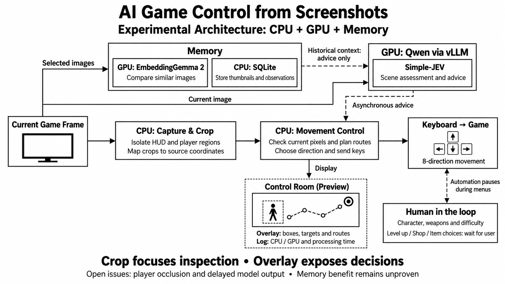

# AI Game Control — Research, Concepts & Selected Benchmarks

A research project by **[lengtsp](https://github.com/lengtsp)** investigating computer-use control from screenshots, hybrid CPU/GPU decisions, and bounded experience memory.

This public edition presents concepts, selected aggregate measurements, unresolved limitations and a beginner tutorial with educational examples. The working controller, production implementation details, complete traces, game knowledge collections and commercial game imagery are excluded.

<p align="center">
  
</p>

*Original English architecture diagram. The image keeps its natural landscape proportions. It summarizes experimental component interfaces; the integrated system has not demonstrated reliable autonomous completion. [Figure notes](docs/FIGURES.md).*

## Try a small example

Start with the [beginner installation and code tutorial](docs/TUTORIAL.md). It includes a CPU-only first-wave walkthrough, an optional Qwen image-inspection client, and upstream setup examples for Simple-JEV and visual Memory.

```bash
python examples/one_wave.py
```

The walkthrough uses invented observations and prints movement recommendations. It does not press game keys, load a model or reproduce the gameplay benchmarks. Human menu choices and the complete Control Room remain outside the public example.

## What is being studied

- A fast CPU process checks current pixels, HUD, route geometry and keyboard input.
- Qwen through vLLM and Simple-JEV provides asynchronous scene/direction advice.
- EmbeddingGemma 2 and SQLite retrieve bounded historical visual cases as advice.
- Human operators choose characters, weapons, difficulty, level-up, shop and items.

A Brotato installation is the motivating test environment. No game artwork, screenshots, scraped wiki corpus or detailed mechanics are distributed in this edition.

## Selected results

| Experiment | Observed result | Meaning and boundary |
|---|---|---|
| Historical offline CPU replay | Median **123.20 → 78.52 ms**, approximately **36.27% lower** | Same replay set; 25 recorded steps per condition, timing for 23. This is CPU pipeline timing. |
| Image embedding service | **120/120 HTTP200**; median **79.50 ms**, p95 **129.56 ms** | Selected stored images; 100 ms spacing after each offer; Qwen was not running concurrently. |
| Initial image-memory corpus | **28 cases / 8 control segments**; **0 positive HP-drop intervals**; **0 complete build labels** | Data availability, not learned skill or retrieval accuracy. |
| Two exploratory memory comparisons | Baseline counter gains **22 / 25**; memory advice **17 / 23**; final HP **16/16** in all four observations | Too few, uncontrolled encounters; no causal gameplay benefit established. |
| Recent recovery handoff | One Resume followed by **96 exploratory pulses** in a 12-second observation | Pause cycling was avoided, but actor-grounded normal control did not recover in that observation. |

These numbers come from different experiments. They must not be combined into an end-to-end reaction time, FPS, accuracy, win rate or product-success claim.

[Benchmark conditions](docs/BENCHMARKS.md) · [Open limitations](docs/LIMITATIONS.md) · [Selected scalar record](docs/evidence/selected-benchmarks.json)

## Memory is implemented; gameplay improvement is unproven

Structured observations, historical image retrieval and post-run lesson drafts are present. Qwen weights are not fine-tuned. More stored cases do not establish better play. The audited image corpus lacks damage examples and complete context labels; drafts are not automatically promoted into policy.

The remaining challenges include separating the player from changing weapons, recovering from occlusion, rejecting stale model outputs, and comparing memory conditions with independent run groups and reviewed relevance labels.

## Research foundations

| Work | Idea adapted in this project |
|---|---|
| [Cradle](https://arxiv.org/abs/2403.03186) | Screenshot-based interaction with keyboard/mouse actions |
| [MIRIX](https://arxiv.org/abs/2507.07957) | Structured visual/episodic memory and retrieval |
| [Reflexion](https://arxiv.org/abs/2303.11366) | Feedback and reflective memory without changing model weights |
| [Prioritized Experience Replay](https://arxiv.org/abs/1511.05952) | Motivation to preserve informative experiences; local HP-change retention is a heuristic, not a PER training implementation |

These are partial conceptual adaptations, not reproductions of the full frameworks or their reported scores. [Research mapping](docs/RESEARCH.md)

## Presentation materials

- [Beginner tutorial and code examples](docs/TUTORIAL.md)
- [Infographic and evidence notes](docs/FIGURES.md)
- [Resources used in the experiments](docs/RESOURCES.md)
- [Public scope](docs/PUBLICATION_SCOPE.md) · [Rights notices](THIRD_PARTY_NOTICES.md)
