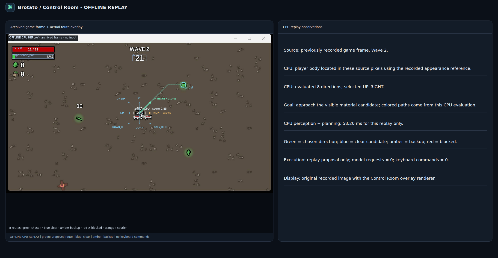
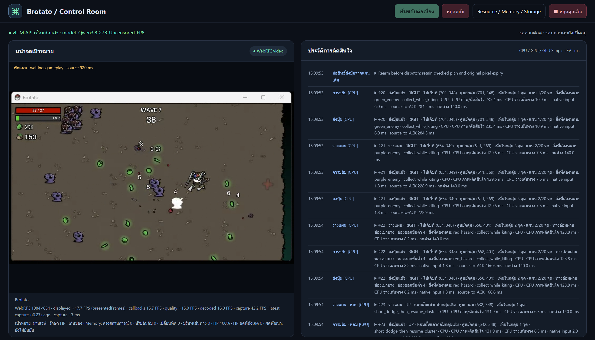

# AI Game Control — Examples, Architecture & Benchmarks

A research project by **[lengtsp](https://github.com/lengtsp)** studying how an AI can observe a game screen, collect resources, avoid hazards and preserve HP.

This public repository contains a beginner tutorial and small educational examples. The complete experimental controller and Control Room implementation remain private. The runnable examples print recommendations or inspect one image; they do not control a game automatically.

- [Control Room preview](#control-room-preview) · [System architecture](#system-architecture)
- [Project root and paths](#project-root-and-paths) · [Install and run](#1-choose-the-parts-you-want-to-try)
- [Measured results](#benchmarks-and-observations) · [Research foundations](#research-foundations)

## Control Room preview

<p align="center">
  
</p>

*Overlay preview captured on 25 October 2026 in an isolated, read-only Control Room renderer. A previously recorded Wave 2 image was processed by the CPU planner. The green route, eight candidate directions, body box and HUD boxes come from that evaluation. The screen explicitly says OFFLINE REPLAY: no model inference or game input was executed. The displayed processing time is a single replay observation, separate from the benchmark samples below.*

The view shows where the controller intends to move, its alternatives and its chosen pickup target. Colored lines describe proposed paths; they do not establish that movement or collection succeeded.

<details>
<summary>Earlier capture from a live Control Room session — 18 October 2026</summary>

<p align="center">
  
</p>

The Thai UI, FP8 model label, displayed counters and timings reflect that historical session. This is an interface example, not a new benchmark or proof of autonomous wave completion.

</details>

## System architecture

<p align="center">
  
</p>

*Original English black-and-white architecture diagram, 1672 × 941 pixels. Both images use their natural proportions: README sets a responsive width without fixing their height.*

The CPU checks current pixels, HUD and routes and delivers keyboard commands in the private controller. Qwen through vLLM and Simple-JEV provides background advice; EmbeddingGemma 2 and SQLite supply historical visual context. Human operators choose characters, weapons, difficulty, level-up, shop and items. Preview overlays expose boxes, targets and routes for inspection; their markings are not new perception evidence.

The architecture describes experimental component interfaces. Not every box is implemented in the public examples, and reliable autonomous play or a gameplay benefit from Memory has not been established.

## Project root and paths

**Project root** means the folder containing this README, `examples/` and `assets/`. It is the directory created by cloning this repository, not `/root`, a Python installation folder or the folder from which your terminal happens to run.

```text
qwen3.8-27b_brotato/             <- PROJECT_ROOT: clone destination
├── README.md                   <- tutorial, usage and results
├── assets/
│   ├── system-architecture-en.png
│   └── control-room-gameplay.png
├── examples/
│   ├── one_wave.py              <- CPU-only planning walkthrough
│   ├── inspect_frame.py         <- optional one-image Qwen client
│   ├── jev_request.json         <- optional classifier request
│   ├── requirements-vision.txt
│   └── test_*.py
└── output/                     <- local generated output; Git-ignored
```

There is no machine-specific root path to edit in the examples. Each script calculates it from its own location:

```python
from pathlib import Path
PROJECT_ROOT = Path(__file__).resolve().parent.parent
```

From the project root, run `python examples/one_wave.py`. To display the detected root, run `python examples/one_wave.py --show-root`.

To run from another directory on Linux/macOS, replace the path below with your clone destination:

```bash
BROTATO_DEMO_ROOT="/absolute/path/to/qwen3.8-27b_brotato"
"$BROTATO_DEMO_ROOT/.venv/bin/python" "$BROTATO_DEMO_ROOT/examples/one_wave.py"
```

On Windows PowerShell:

```powershell
$BROTATO_DEMO_ROOT = "C:\Projects\qwen3.8-27b_brotato"
& "$BROTATO_DEMO_ROOT\.venv\Scripts\python.exe" "$BROTATO_DEMO_ROOT\examples\one_wave.py"
```

Create `.venv` using step 2 before those commands. For `inspect_frame.py`, relative `--image` and `--out` paths are interpreted from **PROJECT_ROOT**. Absolute paths remain absolute. The default output is `PROJECT_ROOT/output/tutorial-observation.json`, independent of your terminal's current folder.

For example, an input path `--image output/my-frame.png` means the file inside this clone's `output/` folder. A path `--out output/result.json` writes there too. Use your own local frame for inspection; the historical UI preview above is not a current game observation. Shell paths such as `-r examples/requirements-vision.txt` and `@examples/jev_request.json` still follow the shell's current directory, so run those installation/curl commands from the project root or supply absolute paths.

## 1. Choose the parts you want to try

| Part | Install | Purpose | Needed for the first example? |
|---|---|---|---|
| CPU planner | Python 3.12+ and Git | Score eight directions using structured observations | Yes |
| Selected-region capture | MSS and Pillow | Capture and encode one visible game region | Optional |
| Qwen inference | Compatible NVIDIA driver, Linux/WSL2, vLLM and licensed vision-model weights | Ask a GPU model to describe one image | Optional |
| Simple-JEV | Upstream HF server in a separate environment | Score a small set of direction labels | Optional |
| Image memory | EmbeddingGemma 2, SentenceTransformers and SQLite | Retrieve a similar previous image | Optional |
| Native input and Control Room | Project-specific private integration | Validated game input, continuous steering, preview and logs | Not included |
| Hermes orchestration | Separate upstream integration | Coordinate higher-level tools | Not required here |

Install [Python](https://www.python.org/downloads/) and [Git](https://git-scm.com/downloads/) first. Capture runs on the computer and desktop session showing the game. A Windows game can use a Windows capture client with a separate Linux/WSL model server. MSS captures visible pixels; this example does not capture an obscured window or keep the game focused in the background.

## 2. Clone and run the CPU example

```bash
git clone https://github.com/lengtsp/qwen3.8-27b_brotato.git
cd qwen3.8-27b_brotato
```

On Linux/macOS, create a small environment:

```bash
python3.12 -m venv .venv
.venv/bin/python examples/one_wave.py
.venv/bin/python -m unittest discover -s examples -p 'test_*.py'
```

On Windows PowerShell:

```powershell
py -3.12 -m venv .venv
.venv\Scripts\python.exe examples/one_wave.py
.venv\Scripts\python.exe -m unittest discover -s examples -p 'test_*.py'
```

No packages, model, GPU, game installation or API key are needed for these commands. The program prints decisions and CPU processing time; it never presses a key. `model_calls: 0` and `model_tokens: 0` describe this CPU-only walkthrough, not the research project's gameplay token usage.

## 3. Understand one simple wave

The walkthrough uses six invented observations from a simplified first wave: loot, an enemy detour, a crossing projectile, healing, late collection and level-up. It prints recommendations for those scenes rather than running a complete game wave.

Read [the teaching planner](examples/one_wave.py). Its reasoning is deliberately small:

1. Require a gameplay label, a confirmed player point, HP/time and a fresh observation. Otherwise recommend no keys.
2. Choose a nearby loot point, favoring small groups. Below 50% HP, prefer visible healing.
3. Keep the destination for at least four seconds while it remains available. Urgent healing, a collected/unavailable target or a menu can end that commitment.
4. Score eight short moves. Favor progress toward the destination, subtract enemy/projectile risk and reject routes through the arena edge.
5. Change the short movement segment to avoid danger while keeping the destination. A four-second plan commitment does **not** mean holding a key for four seconds.
6. Recommend a short key interval; at level-up, return `keys: []` and hand control to the human.

The output includes a case like this; the exact CPU timing is machine-dependent:

```json
{
  "source": "synthetic_tutorial",
  "scene": "Enemy blocks the direct route; keep the destination",
  "status": "recommendation_only",
  "direction": "up_right",
  "keys": ["up", "right"],
  "hold_ms": 150,
  "target": [0.78, 0.5],
  "target_locked_until_s": 4
}
```

The scoring idea is `collection_weight * progress - hazard_risk`, with hard boundary and immediate-collision checks. Moving diagonally is normalized to the same distance as a single-axis move. Projectile checks compare both moving paths, so a crossing bullet can matter even when its final point is distant.

All toy speeds, hit distances, weights and coordinates are educational choices. They are not measured Brotato mechanics. The fixture velocities were written by hand; one screenshot cannot establish velocity. Live integration additionally needs reliable detection, multi-frame tracking, arena/crop coordinate transforms, input acknowledgments and current-window checks. This example neither learns a policy nor proves that its route is optimal.

## 4. Optionally install a Qwen/vLLM server

Skip installation if a compatible server is already running. Check its `/v1/models` endpoint and reuse it; starting another copy of a large model consumes additional GPU memory.

For a new NVIDIA setup, use a separate Linux/WSL environment. Follow the current [vLLM GPU installation guide](https://docs.vllm.ai/en/latest/getting_started/installation/gpu/) for your driver/CUDA combination:

```bash
python3.12 -m venv .venv-vllm
source .venv-vllm/bin/activate
python -m pip install uv
uv pip install vllm --torch-backend=auto
vllm download-kernels
```

Download a vision-capable checkpoint that your hardware and installed loader support. [Qwen's official model card](https://huggingface.co/Qwen/Qwen3.8-27B) documents the base model. The research used a separate NVFP4 checkpoint; this tutorial does not distribute it or promise that every quantized variant runs with the same package versions.

Set your local checkpoint directory, then launch a small **example** context and concurrency budget:

```bash
GAME_MODEL_PATH="/path/to/your/downloaded/vision-model"
vllm serve "$GAME_MODEL_PATH" \
  --served-model-name game-vision \
  --host 127.0.0.1 --port 18130 \
  --tensor-parallel-size 1 --max-num-seqs 1 \
  --max-model-len 8192 --gpu-memory-utilization 0.70 \
  --limit-mm-per-prompt '{"image":1}'
```

In another terminal, check readiness:

```bash
curl http://127.0.0.1:18130/health
curl http://127.0.0.1:18130/v1/models
```

An 8K context is a tutorial starting point, not the research deployment's 220K configuration or a minimum-VRAM guarantee. Model weights, GPU KV cache and inference buffers all need space; two models sharing a GPU need a joint budget. Package support varies by checkpoint. See [vLLM serving](https://docs.vllm.ai/en/latest/serving/online_serving/).

## 5. Optionally inspect one image

Return to the small client environment from step 2. Relative `--image` and `--out` paths start at the detected project root, even when you run the script from another folder. On Linux:

```bash
.venv/bin/python -m pip install -r examples/requirements-vision.txt
.venv/bin/python examples/inspect_frame.py --image /path/to/your-own-frame.png
```

On Windows, capture one selected visible region instead. Replace all four numbers with your game region's actual desktop coordinates and dimensions:

```powershell
.venv\Scripts\python.exe -m pip install -r examples/requirements-vision.txt
.venv\Scripts\python.exe examples/inspect_frame.py --capture 100 100 1280 720
```

Use the game's actual client area, and take a new frame after moving/resizing it. Crops must map back to source coordinates; excluded HUD/black bars and non-square arenas need explicit geometry in a real controller. The CPU toy arena in step 3 is square, so its coordinates are not a drop-in mapping for an arbitrary desktop capture.

The [one-frame client](examples/inspect_frame.py) sends a base64 image to vLLM and writes `output/tutorial-observation.json`. It records image dimensions, request latency, total capture-to-result time and the token usage returned by the server. File images are labeled archival. It does not save a raw screenshot, detect a named game window, OCR the HUD independently, track bullets, validate the model's coordinates or send keyboard input.

The payload uses Qwen's non-thinking settings and a JSON response request; another model may require changes. Unknown fields should remain unknown. A valid JSON object is still an unverified observation. Late or incomplete output is not a movement command. The endpoint must be reachable from the capture client; `127.0.0.1` refers to that client's network context. Optional server authentication uses the local `GAME_MODEL_API_KEY` environment variable.

## 6. Optionally try Simple-JEV

The upstream [Simple-JEV installation and API](https://github.com/featherless-ai/simple-jev) are separate from vLLM chat completions. Its HF server scores next-token choices; installing it does **not** automatically add a classifier route to a resident vLLM process.

For a small standalone CPU exercise, use a separate terminal/environment:

```bash
git clone https://github.com/featherless-ai/simple-jev.git
cd simple-jev
python3.12 -m venv .venv
source .venv/bin/activate
python -m pip install -e './hf-server'
python hf-server/hf_server.py \
  --model Qwen/Qwen3.5-0.8B --device cpu --dtype float32 \
  --port 18174 --classifier-prompt-policy baseline \
  --max-model-len 4096 --max-batch-size 1 --max-batch-tokens 4096
```

From this research repository in another terminal:

```bash
curl http://127.0.0.1:18174/health
curl http://127.0.0.1:18174/v1/classifier \
  -H 'Content-Type: application/json' \
  --data-binary @examples/jev_request.json
```

The [request fixture](examples/jev_request.json) asks for one of eight directions in a synthetic state. Inspect `answers.direction.choice`, its distribution and reported token usage; confidence is not a measured chance of avoiding damage. This CPU server is an API-learning alternative, not the project's shared GPU integration. The tutorial does not implement that custom integration or benchmark this optional server.

## 7. Optionally explore visual Memory

Install in another environment to keep inference dependencies separate:

```bash
python3.12 -m venv .venv-memory
source .venv-memory/bin/activate
python -m pip install -U sentence-transformers transformers Pillow
```

Following the [EmbeddingGemma 2 model card](https://ai.google.dev/gemma/docs/embeddinggemma/model_card_2), this CPU illustration compares two local images:

```python
import torch
from sentence_transformers import SentenceTransformer

encoder = SentenceTransformer(
    "google/embeddinggemma-2", device="cpu",
    model_kwargs={"torch_dtype": torch.float32},
    config_kwargs={"audio_config": None},
)
first = encoder.encode({"image": ["/path/to/your-first-frame.png"]}, normalize_embeddings=True)
second = encoder.encode({"image": ["/path/to/your-second-frame.png"]}, normalize_embeddings=True)
print(float(encoder.similarity(first, second).item()))
```

It prints image similarity, not game skill or retrieval accuracy. For persistent experience, SQLite is included with Python. Store bounded thumbnails/vectors with scene labels, observed HP/time and outcome provenance; filter compatible situations before retrieval. A retrieved record is advice and cannot establish current player coordinates. Measure Memory on/off gameplay outcomes separately. The public benchmark's encoder ran on GPU; this CPU illustration has no matching latency claim. The optional model setup is not rerun as part of this documentation update.

## 8. Know what was checked

Twelve checks passed locally with Python 3.12.3, Pillow 13.0.0 and MSS 10.2.0 installed. Eight test CPU behavior and root-path detection, including stable targets, local detours, all four boundaries, a crossing projectile and menu/unknown/stale rejection. Four check project-relative file paths and the HTTP client with a local mock server, including token reporting, bounded responses and rejection of truncated output. The image-client check needs Pillow and skips when it is absent. These checks do not validate live gameplay or desktop capture. Optional upstream model/server installs are documentation recipes, not an end-to-end reproduction claim. For real measured results, read [benchmark conditions](#benchmarks-and-observations).

The repository intentionally stops before an automatic game-input loop. Continuous play additionally requires phase handoff, fresh actor tracking, bounded key delivery/release, focus handling and an emergency stop. Those remain part of the private experimental controller and its unresolved limitations.

## Benchmarks and observations

Snapshot: 25 October 2026. This is a curated research summary, not a complete experimental export. Separate measurements retain separate denominators.

### Offline CPU replay

| Metric | Earlier path | Accelerated path |
|---|---:|---:|
| CPU pipeline median | 123.20 ms | 78.52 ms |
| Recorded steps / timing samples | 25 / 23 | 25 / 23 |

The reduction is approximately 36.27%. Recorded imagery was replayed with a memory-only input adapter. This tests CPU processing; no new live play or Qwen speedup follows from the result.

### Image embedding API

The latest probe offered five selected stored game-only fixtures repeatedly, with 100 ms between completed offers. It made 120 actual encode requests, all HTTP200. Qwen was not running concurrently.

| Metric | Result |
|---|---:|
| Successes / actual requests | 120 / 120 |
| HTTP median | 79.50 ms |
| HTTP p95, lower order statistic | 129.56 ms |
| HTTP minimum / maximum | 52.75 / 199.17 ms |
| Owner RSS after 30 / 120 offers | 2,498,068,480 / 2,498,076,672 bytes |
| Owner CUDA reserved after 30 / 120 offers | 1,035,993,088 / 1,035,993,088 bytes |

Memory initially rose with shape/runtime warmup, then RSS changed by 8 KiB over those later samples. This is a short test, not proof of long-term leak freedom. GPU allocator statistics omit some driver/context overhead.

An earlier 120-offer run completed 101 encodes and recorded 19 combined busy/unavailable offers. Their exact cause remains unresolved because the old diagnostic grouped statuses together. A later successful run does not retrospectively establish a fix for them.

### Memory and data coverage

The audited visual index has 28 cases across 8 recorded control segments. Wave is known in 28; Danger in 6; character and map in 0. No case has all four labels or a positive interval HP-drop proxy. Pickups and isolated action causation are not independently verified.

Leaving the query's entire segment out, the production known-label filter has another-segment candidates for 24/28 queries. This is candidate coverage, not 85.7% accuracy. Strict complete-build evaluation has 0 eligible queries. Recorded segments are not verified independent runs; adjacent-image random splits would overstate generalization.

Two older exploratory comparisons observed in-combat counter gains 22 / 25 for baseline and 17 / 23 with memory advice, final HP 16/16 throughout. Sample size and uncontrolled encounters prevent a causal conclusion about memory. No gameplay gain is established.

### Selected progression and tokens

| Difficulty label | Recorded completion endpoints | Other retained observations |
|---|---|---|
| Danger 0 | Waves 1–6 | Wave 7 observed; operator reported a loss |
| Danger 2 | Waves 1,2,4 | Wave 7 observed |
| Danger 4 | Waves 6,7 | Recorded death endpoint at Wave 8 |

These are historical segment endpoints, not proof of autonomous full-wave coverage. Missing earlier waves are not inferred.

One selected Danger 0/Wave 2 completion segment has 177 native command ACKs, HP last observed 100%, and 313,419 recorded tokens (313,379 input + 40 output). Across 16 attributable historical segments, recorded response totals sum to 3,034,643 tokens. These are incomplete observed-response totals, not all-run usage or a bill; cached/uncached GPU work was not established.

### Current recovery observation

After a Resume-handoff fix, a 12-second observation recorded 96 exploratory pulses and no repeated Pause cycle. Normal actor-grounded steps remained 0 during that observation. Rendered movement and changing counters were visible, but this does not establish planned pickup quality or robust player tracking.

The proposed diagonal corner-search recovery is software-tested locally. Its live benefit is unmeasured; sending a heading does not prove arrival at a corner or establish a player coordinate.

The latest local correction prioritizes a currently checked plan over random/square exploration. Blind-search configuration no longer enables square steering during normal planning; a short perception gap can retain the original strategic clock without renewing old body/path evidence. A newly acknowledged collection plan replaces the previous search heading, and returning to checked movement clears the search overlay state. Automatic five-second down-right search is no longer the default. GPU advice can continue receiving fresh sources during the recovery state. These changes passed offline behavior/integration checks; a live gameplay improvement has not yet been measured.

## Research foundations

| Work | Idea adapted in this project |
|---|---|
| [Cradle](https://arxiv.org/abs/2403.03186) | Screenshot-based interaction with keyboard/mouse actions |
| [MIRIX](https://arxiv.org/abs/2507.07957) | Structured visual/episodic memory and retrieval |
| [Reflexion](https://arxiv.org/abs/2303.11366) | Feedback and reflective memory without changing model weights |
| [Prioritized Experience Replay](https://arxiv.org/abs/1511.05952) | Motivation to preserve informative experiences; local HP-change retention is a heuristic, not a PER training implementation |

These are partial conceptual adaptations, not reproductions of the full frameworks or their reported scores.


## Limits and attribution

Player/weapon separation, occlusion and stale model output remain unresolved problems. Bounded recovery pulses do not establish a verified player position or successful pickup strategy. A short component memory test does not prove long-term leak freedom; game FPS, capture FPS, preview FPS and command rate are different measurements. Crop and overlay help inspection, but their separate effects on accuracy, latency and scores have not been measured.

The public examples use invented states and teaching parameters. They are not extracted game code, a trained policy, a working replacement for the private controller or a reproduction of the published experiments. Qwen weights are not fine-tuned in this project; stored cases and reflective lesson drafts do not by themselves demonstrate self-improvement.

Brotato and the game content visible in the Control Room captures belong to their rights holders. The experiment used an Epic Games Store installation. This project is not affiliated with or endorsed by the game's creators, Epic Games or Steam. No game installation, sprite/icon collection, scraped wiki corpus, model weights, raw traces, private chat or production controller is distributed here. The architecture artwork and synthetic examples were created for this presentation; cited software and models retain their own terms and licenses.

Social-media drafts and earlier detailed notes stay local. This README contains the installation tutorial, selected results, research references and explanatory material for the public examples.
