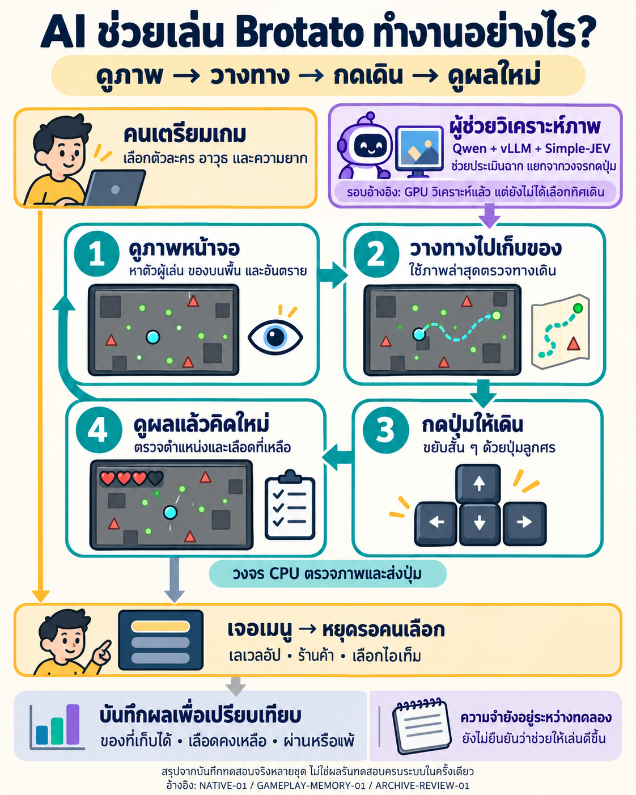
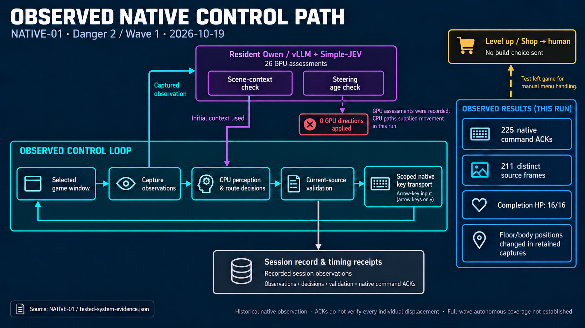
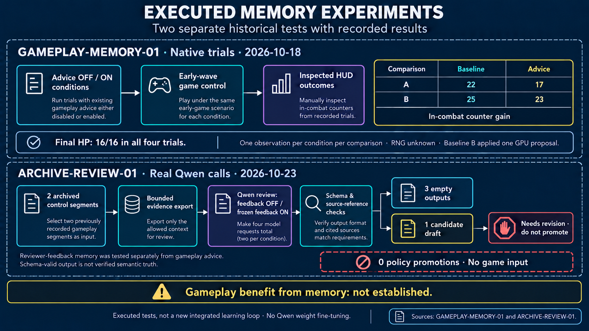
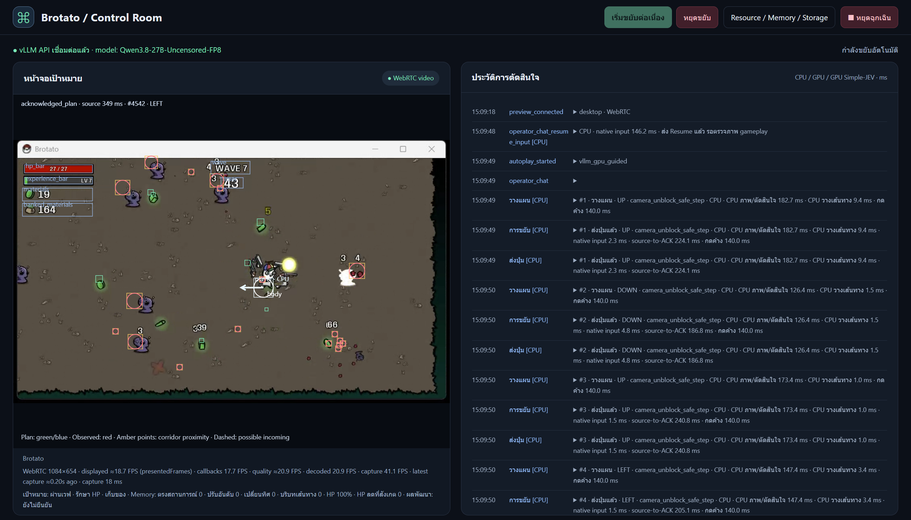

# Brotato AI Control Room — Research & Benchmarks

**A computer-use agent research showcase by [lengtsp](https://github.com/lengtsp).**

This project studies visual game control using a privately maintained local prototype: observe screen pixels, plan collectible routes, avoid hazards and hand menu choices back to a human. The public repository presents **concepts, benchmark methods, selected aggregate results and limited visual examples**. The operational controller, full source code, agent skills, game-reference datasets and private experiment traces are maintained separately.

The central question is whether existing vision-language models, current-geometry control and bounded memory can improve responsiveness, collection and survival **without fine-tuning the Qwen model**. Model quality and full-agent performance are evaluated separately.

## Workflow overview in Thai



An accessible summary of historically executed paths, with human menu handoff and memory limits. The referenced native run used CPU movement; GPU analysis ran but supplied no admitted steering direction. Separate tests are not a single current integrated validation. [Evidence](docs/TESTED_SYSTEM_EVIDENCE.md) · [Image prompt](docs/assets/workflow-overview-th-prompt.txt)

## What has been measured

### Historical CPU / command-continuity replay

| Metric | Scalar baseline | Accelerated pipeline |
|---|---:|---:|
| CPU time median | 123.20 ms | 78.52 ms |
| Command interval median | 145.406 ms | 100.994 ms |
| Renewal gap median | 5.407 ms | 0 ms |
| Steps with a recorded renewal gap | 14 | 0 |

CPU median decreased by approximately **36.27% in this offline replay comparison**. Each mode recorded 25 steps, with timing for 23. The experiment replayed recorded imagery through a memory-only input adapter. These values do not establish faster Qwen inference, current live-game continuity, increased collection or improved survival. [Aggregate observations](docs/evidence/continuity-replay-continuity.json) · [Technique and evidence mapping](docs/TECHNIQUES_AND_EVIDENCE.md)

### Exploratory gameplay memory comparison

| Condition | Trial A: in-combat counter gain | Trial B: in-combat counter gain | Final HP in both trials |
|---|---:|---:|---:|
| Baseline | 22 | 25 | 16/16 |
| Memory advice | 17 | 23 | 16/16 |

**A memory benefit has not been established.** There was one completed observation per condition in each comparison, encounter RNG was unknown, and Trial B's baseline applied one GPU proposal. These trials predate the current local planner. They establish neither a causal memory penalty nor improved perception. [Selected aggregates](docs/evidence/wave1-memory-summary.json) · [Methods and limitations](docs/EXPERIMENTS.md)

### Recorded Danger / Wave progression

| Danger | Waves with recorded completion | Observed without confirmed completion | Recorded death waves | User-reported death waves |
|---|---|---|---|---|
| 0 | 1, 2, 3, 4, 5, 6 | 7 | — | 7 |
| 2 | 1, 2, 4 | 7 | — | — |
| 4 | 6, 7 | 5, 8 | 8 | — |

This reviewed snapshot contains **79 canonical retained controller records** after excluding 1 duplicate legacy baseline; 24 observation-only records are excluded from agent-control claims. A completion endpoint does not establish autonomous full-wave coverage. Unknown labels remain separate; missing earlier waves are not inferred.

Latest requested completion: **Danger 0 / Wave 2**, HP last observed **100%**, **177 command ACKs**, **313,419 recorded model tokens** (313,379 input + 40 output). This is an observed segment total; complete full-round token usage remains unknown.

The user reports a later loss at **Danger 0 / Wave 7**. The retained segment ended before a verified terminal frame; this report is kept distinct from recorded death endpoints.

[Per-wave ledger](docs/WAVE_PROGRESS.md) · [Per-segment tokens and accounting limits](docs/TOKEN_USAGE.md) · [Progress JSON](docs/evidence/danger-wave-progress.json)

[Frame-rate inspection after Wave 7](docs/PERFORMANCE_STATUS.md): WebRTC was configured for 50 FPS, but the observed transport was JPEG, with median reception around 27.9 FPS and capture around 29.2 FPS during a post-game observation. Rendered game FPS remains unmeasured. Recorded command gaps are reported separately.

### Model-specific evaluation

Held-out scene accuracy, acceptable-action-set agreement and controlled model inference p50/p95 have **not yet been measured in the published evaluation card**. Their fields remain `null`. Historical operational GPU timing is reported separately below; it is not a held-out model-quality comparison. [Model evaluation card](docs/evidence/model-evaluation-card.json)

## Tested system paths



**Native test, 2026-10-19 · Danger 2 / Wave 1:** 225 command ACKs, 211 distinct source frames and historically reviewed completion HP **16/16**. Qwen ran **26 GPU assessments**, but **zero GPU steering directions were applied** because they missed the source-age limit. Initial model scene context was used; CPU paths supplied movement. GPU inference median/p95 was **541.877/658.279 ms** in this run. ACKs do not verify every displacement; autonomous coverage of the entire wave was not established.



**Separate executed experiments:** the upper lane reports the four gameplay-advice trials above. The lower lane reports four real Qwen archive-review requests on two segments: three empty outputs and one draft marked **needs revision, do not promote**. There was **no game input and no policy promotion** in that archive review. Neither test establishes a gameplay benefit from memory.

These illustrations reconstruct historical executed paths. They replace figures containing an unexecuted protocol; separate tests do not establish a new end-to-end validation. Human choices cover character, weapon, difficulty, Level up, Shop and items. Current gameplay must be verified before an enabled session resumes movement.

[Figures and prompts](docs/SYSTEM_DIAGRAMS.md) · [Evidence crosswalk](docs/TESTED_SYSTEM_EVIDENCE.md) · [Scalar manifest](docs/evidence/tested-system-evidence.json)

## Techniques and intended benefits

| Technique | Problem addressed | Evidence boundary |
|---|---|---|
| Asynchronous fast/slow control and latest-frame replacement | Avoid waiting for a new model answer per key and accumulating outdated observations | Described private implementation; no new isolated GPU-speed benchmark |
| Goal commitment, hysteresis and main/backup path intent | Preserve collection objectives while finding current detours | Functional design and historical synthetic checks; live collection gain unproven |
| Short temporal association and projectile-path prediction | Consider hazards that may cross the intended next path | Historical synthetic crossing checks; live HP benefit unproven |
| Player/weapon separation and eight-direction control | Add body-grounding and diagonal movement choices | Capability changes, not a measured universal detector/score improvement |
| Contextual retrieval and source-linked reflection | Reuse relevant experience and inspect proposed lessons | Memory benefit remains unproven; no automatic candidate promotion |
| NumPy vectorization and run-based connected components | Reduce Python per-pixel queue work | Existing CPU/replay comparison above; separate from model inference |

[Detailed technique/evidence mapping](docs/TECHNIQUES_AND_EVIDENCE.md) · [Architecture](docs/ARCHITECTURE.md)

## Research foundations

| Work | Idea adapted |
|---|---|
| [VideoAgent](https://arxiv.org/abs/2403.11481) | Structured event/object memory across observations |
| [JARVIS-1](https://arxiv.org/abs/2311.05997) | Experience-conditioned multimodal planning |
| [Reflexion](https://arxiv.org/abs/2303.11366) | Linguistic feedback and episodic reflection without model-weight updates |
| [Voyager](https://arxiv.org/abs/2305.16291) | Reusable skills, feedback and transfer evaluation |
| [AgentGarten](https://arxiv.org/html/2610.12374v2) | Rounds of practice and written playbooks |

These are adaptations of selected ideas, not reproductions of the original systems or their published results. [Simple-JEV](https://github.com/featherless-ai/simple-jev) is the classification/scoring tool; it is listed separately from the research papers. [Research mapping and implementation boundaries](docs/RESEARCH.md)

## Evaluation design

- Separate model classification, visual perception, pipeline latency and full-agent task outcomes.
- Hold the controller/model/build/capture/input settings comparable when testing memory or model variants.
- Separate practice from held-out evaluation; report sample sizes, uncertainty and uncontrolled RNG.
- Measure collection-counter change, HP retention, completion/death, verified idle time and source-to-input p50/p95 separately.
- Treat preview FPS, memory record count and successful retrieval as instrumentation, not proof of intelligence or improved play.

[Full benchmark protocol](docs/EXPERIMENTS.md) · [Memory research](docs/MEMORY_RESEARCH.md)

## Resources in the local prototype

**[Installation requirements and upstream GitHub projects](docs/INSTALLATION.md)** — machine roles, inspected versions, Simple-JEV/Hermes source pins, model serving and optional components. This covers game control; document RAG is outside its scope.

| Component | Role |
|---|---|
| Windows capture worker | Selected game-window observations and original geometry/timestamps |
| CPU / Python / NumPy | Perception, route checks, short-action dispatch and logging |
| GPU / vision-language model / vLLM | Asynchronous model assessment; VRAM depends on the deployed checkpoint and context |
| Simple-JEV | Structured classification and selected-label scoring, not an additional model |
| Local storage / SQLite | Bounded experience, measurements and source-linked candidate review |
| Browser Control Room | Preview, route overlays, decision history, Chat and resource telemetry |
| Human operator | Build/menu choices and uncertain-scene clarification |

Whole-system hardware minimums and universal FPS guarantees have not been established. The development model label was a local serving alias; reproducible model evaluation needs the actual checkpoint revision and quantization. Native observations came from an Epic Games Store installation; Steam compatibility remains unverified. [Resource context](docs/RESOURCES.md)

## One interface example



*One archived screenshot from an earlier prototype version. Displayed timing, FPS and UI settings are historical observations, not current benchmark claims. Artwork retains its original rights.*

## Public materials

```text
README.md                  Research overview and selected measured outcomes
docs/                      Methods, tested architecture, dependencies and research mapping
docs/evidence/             Selected aggregate JSON and an unmeasured model-evaluation card
docs/assets/               One interface example and evidence-bound system figures with prompts
```

[Concise Facebook post in Thai](docs/FACEBOOK_POST_TH.txt) · [Detailed Thai project review](docs/PROJECT_REVIEW_TH.md) · [Publication scope](docs/KNOWLEDGE.md) · [Third-party notices](THIRD_PARTY_NOTICES.md)

This repository provides an upstream dependency/installation inventory, but no runnable controller distribution. The private integration is also needed to operate the complete system. Raw traces, detailed game knowledge, private memory databases, model weights and full runtime code are not part of the current public tree. Historical validation records describe previous private-source snapshots, not tests runnable from this showcase.

Brotato and its artwork belong to their rights holders. This independent project is not affiliated with or endorsed by Blobfish or Epic Games. The public main branch has been rebuilt from this research-only snapshot without earlier implementation commits as ancestors. Existing external clones, copies and cached objects are outside that branch-history change.
