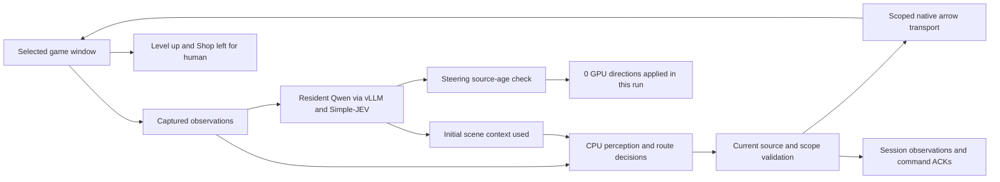

# Architecture and its test boundary

This diagram describes **NATIVE-01, the documented 2026-10-19 Danger 2 / Wave 1 native retest**. It is narrower than the current private prototype. [Evidence and caveats](TESTED_SYSTEM_EVIDENCE.md) distinguish native execution, real archive-model calls, offline replay and synthetic checks.

The run recorded 225 command ACKs, 211 distinct source frames and completion HP16/16. CPU paths supplied movement. GPU inference ran 26 assessments, but no steering direction met the source-age requirement. ACKs do not establish every displacement; full-wave autonomous coverage was not verified.

## Features outside that single diagram

The private prototype also includes latest-observation replacement, route commitment, main/backup intent, short temporal association, projectile crossing checks and eight-direction actions. [Techniques and evidence](TECHNIQUES_AND_EVIDENCE.md) describes their individual support; implementation does not prove better live collection/survival or current end-to-end validation.

Human choices cover character, weapon, difficulty, Level up, Shop and items. Current gameplay must be verified before an enabled session resumes movement. Uncertain body identity, scene transitions and stale evidence interrupt input.

Short visual history, gameplay advice, candidate reflection and reviewer feedback are separate memory mechanisms. [Executed memory tests](SYSTEM_DIAGRAMS.md) are shown separately. Drafts were not automatically promoted, and a gameplay benefit is unestablished. Held-out evaluation remains a textual [research protocol](EXPERIMENTS.md).

This repository publishes architecture, dependencies and selected measurements; operational code/configuration stay private. [Installation inventory](INSTALLATION.md)
