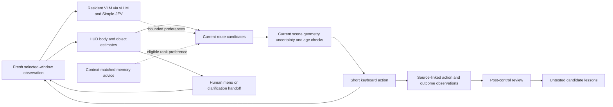

# Conceptual architecture

The local prototype combines current visual observations, bounded route intent, asynchronous semantic assessment and human menu decisions. This repository publishes the architecture and measurements; its operational implementation is maintained separately.

The fast loop checks current geometry and the controlled body. The slower model loop supplies proposals. A replaceable latest observation prevents a backlog from becoming a queue of executable old decisions. Future route waypoints and recalled experiences remain intentions, not blind key sequences.

Main/backup intent can preserve a current collectible objective while checking alternative immediate approaches. Short relative-motion estimates require recent valid associations; uncertain identity or unmatched observations do not provide verified velocity. Scene transitions, stale evidence and ambiguous bodies interrupt movement.

Eight directions include two orthogonal keys for diagonals. Human choices cover character, weapon, difficulty, Level up, Shop and items. Current gameplay must be verified before an existing session continues.

Short visual history, episodic experience, candidate review and reviewer-error feedback are distinct mechanisms. Draft lessons do not automatically enter live control. [Technique/evidence mapping](TECHNIQUES_AND_EVIDENCE.md) and [benchmark methods](EXPERIMENTS.md) distinguish intended benefits from established results.
