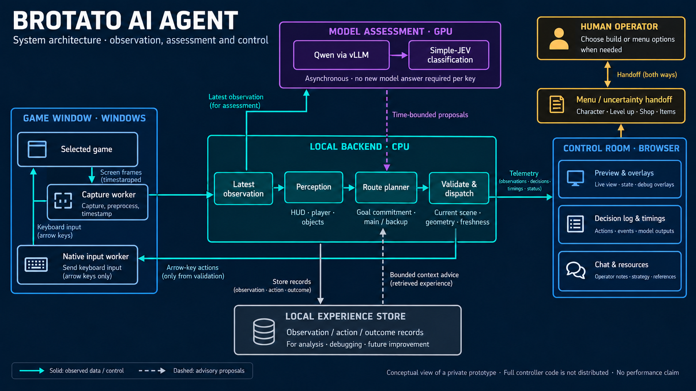
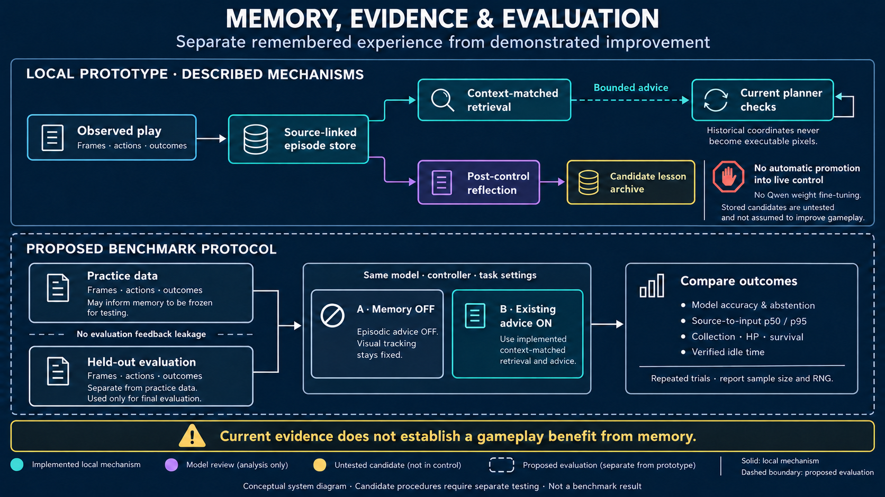

# System diagram views

These are conceptual illustrations of the private local prototype and its evaluation design. They add two views to the existing [workflow overview](assets/workflow-research.png). They contain no game reference assets, controller source or numeric performance claims.

## Deployment and control/data flow

- The Windows capture worker supplies observations with original geometry and timestamps.
- The CPU backend forms current observations, estimates HUD/body/objects, plans eligible routes, and validates evidence before short native key actions.
- Qwen via vLLM and Simple-JEV supplies time-bounded proposals to planning. The GPU container denotes the inference path; the classification adapter and orchestration can also use CPU work. It is not a second direct keyboard owner, and no new model response is required for every key.
- Control Room displays preview, overlays, decisions, timings and resources. The operator handles build/menu choices and uncertainty handoffs.
- Experience is stored for analysis and bounded context advice; a retrieved record cannot authorize historical coordinates as current input.

Solid arrows show data/control paths; dashed arrows show advisory proposals. The diagram summarizes roles, not every transport connection or implementation detail. [Generation and correction prompts](assets/system-architecture-prompt.txt)

## Memory, evidence and evaluation

The top section describes separate local mechanisms: source-linked records, context-matched retrieval and post-control reflection. Retrieved advice can influence already eligible preferences. Candidate lesson drafts remain in a separate archive with **no automatic promotion into live control**. No Qwen fine-tuning is implied.

The dashed lower section is a **proposed evaluation protocol**, not an already completed benchmark. Practice data may inform memory, which should then be frozen for held-out evaluation. Keep visual tracking, model, controller and task settings comparable; switch episodic advice OFF versus ON. Do not use held-out outcomes to revise memory during the evaluation.

Measure model classification and abstention, source-to-input p50/p95, collection/HP/survival and verified idle time separately. An improvement in one helper, successful retrieval or a larger store is not a measured gameplay benefit. The existing limited memory observations do not establish such a benefit. [Generation and correction prompts](assets/memory-evaluation-prompt.txt)

## Provenance and related material

Both diagrams were made with the built-in image generation tool on 2026-10-23, then given narrow technical corrections for capture arrow direction and the baseline's unchanged visual tracking. They are explanatory artwork, not official game imagery, measured result plots or evidence of complete implementation/reproduction of cited research.

[Architecture narrative](ARCHITECTURE.md) · [Research mapping](RESEARCH.md) · [Benchmark protocol](EXPERIMENTS.md) · [Recorded Danger/Wave progression](WAVE_PROGRESS.md)
